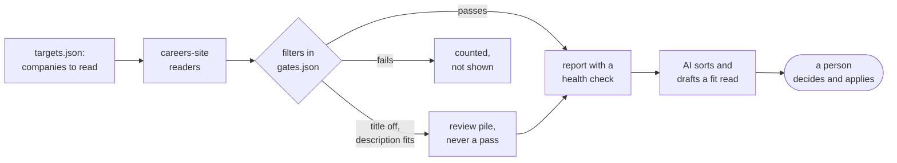

<p align="center">
  <picture>
    <source media="(prefers-color-scheme: dark)" srcset="docs/brand/lockup-animated-dark.svg">
    
  </picture>
  <br><sub>Max Q is the moment a rocket takes the most stress on the way up.</sub>
</p>

<p align="center"><a href="https://github.com/mpwilso/Project-Max-Q/actions/workflows/tests.yml"></a></p>

<p align="center"><b>A slow week and a broken search look the same. Max Q tells them apart.</b></p>

Max Q reads job postings straight from company careers sites, filters out the ones that don't fit, and gives you a short list to decide on. It never applies for you.

Status: a portfolio project, built to show how I design, test and judge an AI tool, and the tool I used on my own 2026 job search, which ended with multiple interviews and offers. The fit scorer was measured on one set of 24 made-up postings: it agreed with the label 79% of the time, against 46% for keyword matching ([evals/results/](evals/results/), misses included).

Each run writes a report. It opens with a health check that accounts for every posting and every company, then lists the matches. Trimmed from [reports/SAMPLE_REPORT.md](reports/SAMPLE_REPORT.md):

```
Funnel: 2364 postings from 7 employers -> 1107 title excluded, 1066 title out of lane,
        95 no US location, 51 outside your markets, 5 over the years limit
        -> 17 for review -> 22 PASS. 0 employers unread.

Databricks · Senior Customer Enablement Program Manager
  Location:        United States
  Comp:            $117,400 - $161,350
  Conversion read: LOW · years gap +2 (6+ stated vs 4.5 held) · posted 138d ago · flooded board
  Flags:           VERIFY LOCATION: the board names only the country; REACH: 6+ years stated
```

**At a glance**
- Reads 39 kinds of company careers sites directly, with no job-listing sites in between ([adapters/](adapters/), plus the built-in readers in [sweep.py](sweep.py)).
- In the sample run, 2,364 postings from seven companies came down to 22 matches and 17 for a person to review, and every company was read ([reports/SAMPLE_REPORT.md](reports/SAMPLE_REPORT.md)).
- 695 automated tests, none of which call a model or the network, run on every push ([tests/](tests/), [tests.yml](.github/workflows/tests.yml)).

## What it does



| Step | Who decides |
|---|---|
| Read careers sites, apply the filters, find sites that couldn't be read | Code (tested, same answer every time) |
| Sort the unscored pile, draft a fit assessment | AI agent |
| Which roles are worth an application | Person |
| Submitting anything | Person, always |

- **Reads each company's own careers site**, never a job-listing site. A site it could not read is reported as UNCOVERED, never as a quiet empty board, and nothing is marked closed unless the whole site was read cleanly. It names itself, goes slowly and checks robots.txt ([docs/CRAWLING.md](docs/CRAWLING.md)).
- **Filters in code.** Title, a location rule that fails closed, a required-years limit and out-of-scope fields, every threshold in `gates.json`. A posting whose title is off but whose description fits goes to a review pile, never a pass. A suspiciously small result is treated as a bug until the numbers explain it ([docs/CONFIG.md](docs/CONFIG.md)).
- **Scores two separate questions**: whether the candidate fits, and whether an application will reach a person (required years, a level jump, an old posting, a flooded board).
- **Ranks the short list with Claude**, if you choose it. Code checks the structured answer, sets the verdict from the score, and makes any named dealbreaker a skip. The ranking changes the order and nothing else; a person still decides.
- **Blocks a resume line** that no verified claim about the candidate supports, and holds interview prep to the same claims (below).

## Try it

Python 3.12. About two minutes to a report of your own. No API key or account needed.

```
python3 -m venv .venv
source .venv/bin/activate        # Linux and macOS
pip install -r requirements.txt

python sweep.py --selftest                                    # offline: sample postings through the filters
python -m unittest discover -s tests -t .                     # offline: the full test suite
python sweep.py --targets examples/targets.quickstart.json    # live: three small public careers sites
```

The live run takes about a second and writes `reports/SWEEP_REPORT_<date>.md`. What it does not do: apply to jobs, log in anywhere, read LinkedIn or job-listing sites, or call an AI model unless you choose the Claude scorer.

Windows, a full run of `targets.json`, probing one company and the maintainer's hooks: [docs/SETUP.md](docs/SETUP.md). Your own search (`gates.json`, `targets.json`, your own profile for the scorer) and what the report's terms mean: [docs/CONFIG.md](docs/CONFIG.md).

## What was measured

`evals/run_fit_eval.py` scores 24 made-up postings labeled apply, maybe or skip, including traps: the right title on the wrong job, the right job under an odd title, a good job in a place he can't work. The baseline is plain keyword matching.

| Scorer (24 postings) | Agrees with label | Apply precision | Apply recall | Bad jobs pushed to the top |
|---|---|---|---|---|
| Keyword baseline ([report](evals/results/fit_baseline.md)) | 46% | 42% | 83% | 3 of 12 |
| Claude (Opus 5.5), before the dealbreaker rule<sup>1</sup> | 67% | 50% | 100% | 3 of 12 |
| Claude, plus the dealbreaker rule ([report](evals/results/fit_claude-code.md)) | 79% | 67% | 100% | 0 of 12 |

<sup>1</sup> The report from that run was not kept. Its numbers are recomputed from the same recorded answers ([evals/recorded/](evals/recorded/)) with the verdict taken from the score alone, the rule the code had at the time.

Claude's run before the rule caught every good job but pushed three bad ones to the top: five days onsite in New York, a role in Canada, and a six-month contract. In each case the model had named the problem as a dealbreaker and still scored the job 78 to 90, because location is 10 points of the rubric. The fix went in code, not the prompt: a dealbreaker now makes the verdict skip ([defect 9](docs/DEFECT_LOG.md#9-the-ai-scorer-saw-the-dealbreaker-and-scored-the-job-90-anyway)). The third row replays the same recorded answers under the new rule, so no model call changed. What these numbers do and do not show is under [Limits](#limits).

## Keeping the resume truthful

A tailored resume is where an AI assistant is most tempted to embellish. `claimcheck.py` stops that in code: every bullet must cite a verified claim about the candidate (`[claim-id]`), and a line is blocked if it states a figure, a system or a title those claims don't support, anything on the never-claim list, implied people management, a hedged figure, an AI-tell word or an em dash. One blocked line blocks the whole resume, so the fix is to change the wording or add a verified claim, never to talk the check out of it.

```
python claimcheck.py examples/john_doe/resume.md            # every line traces: passes
python claimcheck.py examples/john_doe/resume_blocked.md    # 5 of 6 lines blocked, with reasons
```

`claimcheck.py --spoken` holds interview prep packs, story files and mock transcripts to the same claims; the workflow is in [docs/INTERVIEW_PREP.md](docs/INTERVIEW_PREP.md).

## Limits

- The fit scorer's numbers come from one set of 24 made-up postings, labeled by the same model family that does the scoring, under a dealbreaker rule chosen after seeing that set. A fresh set is the real test.
- Browser impersonation is off by default, so Meta's careers site is reported as skipped unless you opt in. robots.txt is checked; a file that cannot be fetched allows every path, and the host is named.
- Six kinds of careers site have a reader and a test but no example company in `targets.json`.

The full list, with the switches: [docs/LIMITS.md](docs/LIMITS.md).

## How it was built

Claude Code wrote most of the code. I wrote the rules it had to follow ([docs/AGENT_RULES.md](docs/AGENT_RULES.md)), decided what it could and couldn't decide on its own, and held it to one standard: any bug found in real data got a test before we moved on. The bugs, with the test that now guards each one, are in [docs/DEFECT_LOG.md](docs/DEFECT_LOG.md); when a written rule didn't stop the agent repeating a mistake, the rule became a check that blocks the commit ([defect 12](docs/DEFECT_LOG.md#12-a-one-line-edit-that-rewrote-the-whole-file)). Built on personal time and equipment, independent of any employer.

Reading the code? Start small: [adapters/tiktok.py](adapters/tiktok.py) is one careers-site reader (126 lines), [claimcheck.py](claimcheck.py) is the resume check (334 lines; [spokencheck.py](spokencheck.py) runs it on interview prep), [fitscore.py](fitscore.py) is the scorer, and [sweep.py](sweep.py) is the 5,500-line engine that runs everything else.

What I would do next: a second, independently labeled set to confirm the fit scorer's numbers; more page checks before any reviewer sees a draft (one page, unsupported metrics); an independent review pass and a person's approval before a file is released.

## The other tools

This is one of six tools. Three run in order: [Loupe](https://github.com/mpwilso/loupe) writes the story, [Parallax](https://github.com/mpwilso/parallax) builds it in a sandbox and keeps the record, and [ISR](https://github.com/mpwilso/isr) tells the person accepting it what is left to check. Three stand alone: [Polarizer](https://github.com/mpwilso/polarizer) holds an agent's risky tool calls until a person approves them, [Mordecai](https://github.com/mpwilso/mordecai) judges whether a Claude skill helps, and Max Q ranks job postings against a profile. Each runs on its own. The three were run in order once, on one change: [ISR's run log](https://github.com/mpwilso/isr/blob/master/docs/run-log.md).

## License

[MIT](LICENSE).

Built by Matt Wilson · [LinkedIn](https://www.linkedin.com/in/mwilso)
